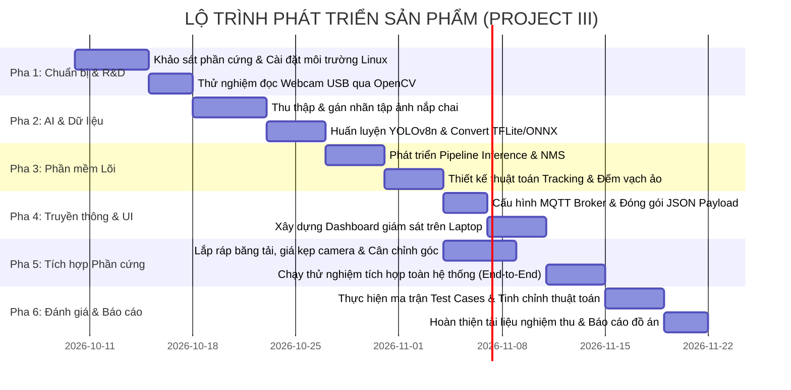

# Kế Hoạch Tổng Thể Phát Triển Sản Phẩm (Master Product Plan)
**Dự Án:** Hệ Thống Edge AI Đếm Nắp Chai Trên Băng Chuyền Mini (Project III)  
**Tài liệu tham chiếu:** [Docs/](file:///d:/2026.1/ProjectIII/Docs)

---

## 1. Giới thiệu tổng quan
Hệ thống **Edge AI Đếm Nắp Chai** là sản phẩm thực nghiệm công nghệ thuộc đồ án Project III, kết hợp giữa phần cứng nhúng biên (**Arduino Qualcomm Linux Board, 2GB RAM**), camera thị giác máy tính (**Webcam USB chuẩn UVC**) và mô hình học sâu rút gọn (**YOLOv8 Nano / YOLO11 Nano** chuyển đổi sang định dạng TFLite/ONNX). 

Sản phẩm giải quyết bài toán đếm tự động số lượng sản phẩm/nắp chai trên dây chuyền sản xuất mô phỏng với độ chính xác cao, chi phí tối ưu, xử lý tại chỗ không phụ thuộc điện toán đám mây và truyền kết quả tức thời qua **giao thức MQTT (JSON payload)**.

---

## 2. Mục tiêu sản phẩm & Tiêu chí thành công (OKRs / KPIs)

### 2.1. Mục tiêu kỹ thuật (Technical KPIs)
| Tiêu chí | Mục tiêu cam kết (Target) | Ngưỡng tối thiểu chấp nhận |
| :--- | :--- | :--- |
| **Tốc độ khung hình (FPS)** | $\ge 12 - 15$ FPS trên board Arduino | $\ge 10$ FPS |
| **Độ chính xác nhận diện ($mAP@0.5$)** | $\ge 90\%$ trên tập test nắp chai | $\ge 85\%$ |
| **Độ chính xác đếm (Counting Accuracy)** | $\ge 96\%$ ở tốc độ trượt chuẩn | $\ge 92\%$ |
| **Mức chiếm dụng bộ nhớ (RAM)** | $\le 1.2$ GB / 2GB RAM | $\le 1.6$ GB |
| **Độ trễ truyền tin MQTT** | $\le 100$ ms trên mạng nội bộ | $\le 250$ ms |
| **Tỷ lệ đếm lặp / sót (Error Rate)** | $\le 4\%$ | $\le 8\%$ |

### 2.2. Mục tiêu sản phẩm & Đồ án (Project Deliverables)
1. **Phần cứng hoàn thiện:** Khung giá kẹp Webcam UVC 90°, bo mạch Arduino Qualcomm Linux, cơ cấu trượt/băng tải mini chạy ổn định.
2. **Bộ mã nguồn phần mềm hoàn chỉnh:**
   - Script Edge Inference & Logic đếm qua vạch ảo chạy tự động trên Linux.
   - Script MQTT Publisher gửi số liệu JSON theo thời gian thực.
   - Ứng dụng/Dashboard nhận dữ liệu giám sát trên Laptop (Subscriber).
3. **Bộ dữ liệu & Mô hình AI:**
   - Dataset ảnh nắp chai được gán nhãn chuẩn YOLO (500 - 1000 ảnh đa dạng góc chụp/ánh sáng).
   - Trọng số mô hình đã nén và tối ưu hóa (`.tflite` / `.onnx`).
4. **Bộ hồ sơ tài liệu sản phẩm & kiểm thử:** Đầy đủ PRD, System Design, Test Cases và Biên bản thử nghiệm thực tế.

---

## 3. Lộ trình phát triển sản phẩm (Phased Roadmap)

Quy trình phát triển được phân bổ thành 6 giai đoạn (Phase) thực thi tuần tự và song song:

---

## 4. Danh mục tài liệu trong thư mục Product

Kế hoạch phát triển sản phẩm bao gồm các tài liệu thành phần được quản lý tại [product/](file:///d:/2026.1/ProjectIII/product):

1. [00_TongQuan_KeHoachPhatTrien.md](file:///d:/2026.1/ProjectIII/product/00_TongQuan_KeHoachPhatTrien.md): Tài liệu này - Kế hoạch tổng thể, mục tiêu KPIs và lộ trình sản phẩm.
2. [01_DacTaYeuCauSanPham_PRD.md](file:///d:/2026.1/ProjectIII/product/01_DacTaYeuCauSanPham_PRD.md): Bản đặc tả yêu cầu sản phẩm chi tiết (PRD - Chức năng & Phi chức năng).
3. [02_KienTrucVaThietKe_SystemDesign.md](file:///d:/2026.1/ProjectIII/product/02_KienTrucVaThietKe_SystemDesign.md): Thiết kế kiến trúc module, luồng dữ liệu và cấu trúc source code.
4. [03_LoTrinhTrienKhai_WBS_Roadmap.md](file:///d:/2026.1/ProjectIII/product/03_LoTrinhTrienKhai_WBS_Roadmap.md): Phân rã công việc chi tiết (WBS), danh mục task và phân bổ nguồn lực.
5. [04_KeHoachKiemThuVaDanhGia_TestPlan.md](file:///d:/2026.1/ProjectIII/product/04_KeHoachKiemThuVaDanhGia_TestPlan.md): Kế hoạch kiểm thử, kịch bản thử nghiệm và ma trận đánh giá sai số.

---

## 5. Quản trị rủi ro (Risk Management)

| Rủi ro tiềm ẩn | Mức độ | Hậu quả | Biện pháp giảm thiểu |
| :--- | :--- | :--- | :--- |
| **FPS thấp trên Arduino (< 8 FPS)** | Cao | Đếm sót nắp chai khi băng tải chạy nhanh | - Resize ảnh xuống 480x480 hoặc 320x320. - Lượng tử hóa mô hình INT8 (Quantization). - Tận dụng NPU/DSP Qualcomm thay vì thuần CPU. |
| **Đếm trùng khi nắp đứng yên trên vạch** | Trung bình | Sai lệch lớn số lượng đếm | Áp dụng logic Tracking gán ID trạng thái (`is_counted = True`) và chỉ reset khi nắp đã vượt hẳn khỏi vùng đệm (buffer zone). |
| **Điều kiện ánh sáng Lab thay đổi** | Trung bình | Tụt độ tin cậy phát hiện (Confidence < 0.5) | Bổ sung ảnh chụp dưới nhiều cường độ sáng khác nhau vào tập huấn luyện; áp dụng Data Augmentation (Brightness/Contrast). |
| **Nhiệt độ board tăng cao gây hạ xung (Throttling)** | Thấp | Tụt FPS sau 15-20 phút chạy liên tục | Lắp tản nhiệt nhôm (Heatsink) tản nhiệt thụ động, bổ sung quạt 5V nếu cần thiết. |
| **Mất kết nối Wi-Fi/MQTT Broker** | Thấp | Không gửi được dữ liệu về máy tính | Lưu bộ đệm số đếm (buffer counter) cục bộ trong RAM; tự động thử kết nối lại (Auto-reconnect). |

---

## 6. Giới hạn của sản phẩm (Product Limitations)
Để đồ án hoàn thành đúng tiến độ và phù hợp năng lực phần cứng phòng Lab, hệ thống xác định các giới hạn sau:
1. **Phần cứng nhúng biên (2GB RAM):** Chỉ tối ưu cho các mô hình AI rút gọn (YOLO Nano INT8/FP16), duy trì tốc độ $10 - 15$ FPS ở $640 \times 480$.
2. **Vận tốc băng chuyền:** Phù hợp với dải tốc độ mô hình học tập ($0.1 - 0.3$ m/s), không áp dụng cho dây chuyền siêu tốc công nghiệp.
3. **Cơ cấu quang học:** Cố định góc nhìn từ trên xuống ($90^\circ \pm 10^\circ$) khoảng cách 25 - 40 cm; không hỗ trợ phát hiện nắp bị xếp chồng khuất tầm nhìn 2D.

