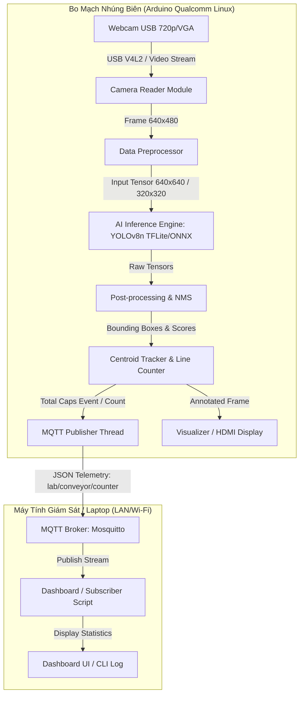

# Tài Liệu Thiết Kế Kiến Trúc Hệ Thống (System Design & Architecture)
**Dự Án:** Hệ Thống Edge AI Đếm Nắp Chai Trên Băng Chuyền Mini  
**Phiên Bản:** 1.0  
**Tài liệu liên quan:** [Docs/](file:///d:/2026.1/ProjectIII/Docs) | [01_DacTaYeuCauSanPham_PRD.md](file:///d:/2026.1/ProjectIII/product/01_DacTaYeuCauSanPham_PRD.md)

---

## 1. Kiến trúc tổng thể hệ thống (System Architecture)

Hệ thống được thiết kế theo mô hình **Edge-to-Monitoring Architecture**, chia làm hai phân hệ vật lý tách biệt:



---

## 2. Thiết kế chi tiết các Module phần mềm (Software Modules)

Hệ thống mã nguồn trên thiết bị biên được phân chia thành các module hướng đối tượng độc lập:

### 2.1. Module `CameraReader` (`src/core/camera.py`)
- **Trách nhiệm:** Kết nối và duy trì luồng ảnh ổn định từ Webcam USB.
- **Tính năng chính:**
  - Khởi tạo camera qua OpenCV: `cv2.VideoCapture(device_index)`.
  - Cấu hình kích thước khung hình ($640 \times 480$), FPS ($15$ - $30$).
  - Bộ đệm 1 frame (`cv2.CAP_PROP_BUFFERSIZE = 1`) nhằm loại bỏ độ trễ do tích tụ khung hình cũ.
  - Xử lý mất kết nối: Tự động khởi tạo lại sau mỗi khoảng chờ nếu đọc frame bị lỗi `ret == False`.

### 2.2. Module `ObjectDetector` (`src/core/detector.py`)
- **Trách nhiệm:** Nạp mô hình AI đã tối ưu hóa và thực hiện suy luận tìm nắp chai.
- **Công nghệ lõi:**
  - Hỗ trợ cả hai backend: `tflite_runtime.interpreter.Interpreter` (ưu tiên) hoặc `onnxruntime.InferenceSession`.
  - Hàm `preprocess(frame)`: Chuyển đổi BGR sang RGB, resize theo chuẩn mô hình, chuẩn hóa chia 255.0, định hình tensor `[1, H, W, 3]`.
  - Hàm `postprocess(outputs)`: Thực hiện Non-Maximum Suppression (NMS) để loại bỏ các box trùng lặp, trả về danh sách các Bounding Box dạng `[x1, y1, x2, y2, confidence, class_id]`.

### 2.3. Module `CentroidTracker` & `LineCounter` (`src/core/tracker.py`, `src/core/counter.py`)
- **Trách nhiệm:** Theo dõi vị trí các nắp chai qua thời gian và xác định hành vi cắt qua vạch ảo.
- **Thuật toán theo dõi (Centroid Tracking):**
  - Tính tọa độ tâm nắp chai: $X_c = \frac{x_1 + x_2}{2}, \quad Y_c = \frac{y_1 + y_2}{2}$.
  - Tính khoảng cách Euclidean giữa tâm các box ở frame hiện tại với các object đã ghi nhận ở frame trước.
  - Gán `object_id` duy nhất cho từng nắp chai đang di chuyển trong khung nhìn.
- **Logic đếm vạch ảo (Virtual Line Crossing Logic):**
  - Khởi tạo vạch đếm nằm ngang tại $Y = Y_{line}$ với dải đệm $\delta$ ($Y_{line} - \delta \le Y \le Y_{line} + \delta$).
  - Trạng thái cắt vạch:
    $$\text{Đếm hợp lệ khi: } Y_{c, t-1} \le Y_{line} \quad \text{và} \quad Y_{c, t} > Y_{line} \quad \text{và} \quad \text{status}(id) \ne \text{"COUNTED"}$$
  - Đánh dấu trạng thái `status(id) = "COUNTED"` để ngăn ngừa đếm lặp tuyệt đối.
  - Xóa `object_id` khi vật thể đi ra khỏi mép dưới của khung hình ($Y_c > \text{Height} - 10$).

### 2.3b. Module `ColorAnalyzer` (`src/core/color_analyzer.py`)
- **Trách nhiệm:** Trích xuất và phân loại màu sắc của từng nắp chai từ ảnh cắt vùng lõi (Center ROI 50%).
- **Chiến lược phân loại 4 tầng:**
  1. **Đơn sắc (Single Dominant):** Tỷ lệ màu top 1 $r_1 \ge 70\%$ (hoặc $\ge 55\%$ và cách biệt hoàn toàn màu 2) $\to$ Gán nhãn đơn sắc (`red`, `blue`, `green`, `yellow`, `white`).
  2. **Phối 2 màu (Dual-Color / Bicolor):** Phục vụ các loại nắp in logo/chữ (như Coca đỏ-trắng `red_white`, Pepsi xanh-trắng `blue_white`). Khi $r_1 \ge 25\%, r_2 \ge 20\%$, tổng $r_1 + r_2 \ge 50\%$ và $r_2 - r_3 \ge 8\%$.
  3. **Đa màu (Multicolor):** Xảy ra khi nắp có $\ge 3$ màu phân bổ đều ($\approx 30\text{--}33\%$, không màu nào vượt trội $\ge 45\%$) $\to$ Gán nhãn `multicolor` (hiển thị khung cam neon).
  4. **Màu lạ (Unknown Color):** Khi màu nắp nằm ngoài bảng cấu hình hoặc tỷ lệ nhận diện $< 30\%$ $\to$ Gán nhãn `unknown` (hiển thị khung tím hồng cảnh báo).

### 2.4. Module `MqttClient` (`src/comms/mqtt_client.py`)
- **Trách nhiệm:** Kết nối MQTT Broker trên mạng LAN, đóng gói JSON và xuất bản không chặn (non-blocking).
- **Tính năng chính:**
  - Sử dụng thư viện `paho-mqtt`.
  - Chạy vòng lặp mạng trên luồng nền (`client.loop_start()`).
  - Hỗ trợ 2 chế độ gửi:
    1. **Event-driven:** Phát tức thì khi có sự kiện nắp chai vừa cắt qua vạch (`total_caps` tăng).
    2. **Heartbeat:** Định kỳ 2 giây/lần gửi gói tin báo cáo trạng thái hệ thống, phân loại màu và FPS.

### 2.5. Module `Visualizer` (`src/utils/visualizer.py`)
- **Trách nhiệm:** Vẽ đồ họa trực quan phục vụ quan sát trực tiếp trên màn hình/HDMI.
- **Thành phần hiển thị:**
  - Đường kẻ vạch ảo (màu đỏ: chưa kích hoạt, màu xanh lá: khi vừa có vật thể cắt qua).
  - Khung Bounding Box có màu tương ứng với màu nắp (màu cam cho `multicolor`, màu tím hồng cho `unknown`).
  - Bảng OSD góc trái: `TOTAL`, `FPS`, `SRC`, `MQTT`.
  - Bảng `COLOR STATS` góc phải: Tự động hiển thị và thống kê số lượng theo từng nhóm màu.

---

## 3. Quy chuẩn gói tin dữ liệu (Data Contracts)

### 3.1. MQTT Topic
- Topic chính: `lab/conveyor/counter`
- Topic điều khiển/cấu hình (mở rộng): `lab/conveyor/command`

### 3.2. Cấu trúc JSON Payload
```json
{
  "device_id": "arduino_lab_node",
  "timestamp": 1728196993,
  "total_caps": 24,
  "counts_by_color": {
    "red": 10,
    "blue": 6,
    "white": 3,
    "red_white": 2,
    "multicolor": 2,
    "unknown": 1
  },
  "fps": 14.8,
  "status": "running"
}
```

| Tên trường | Kiểu dữ liệu | Mô tả | Ví dụ |
| :--- | :--- | :--- | :--- |
| `device_id` | String | Tên định danh thiết bị biên phát tin | `"arduino_lab_node"` |
| `timestamp` | Integer | Dấu thời gian chuẩn Unix Epoch (giây) | `1728196993` |
| `total_caps` | Integer | Tổng số lượng nắp chai tích lũy đã đếm | `24` |
| `counts_by_color` | Object | Thống kê số lượng nắp theo từng màu (đơn sắc, 2 màu, đa màu, unknown) | `{"red": 10, ...}` |
| `fps` | Float | Tốc độ xử lý khung hình trung bình tức thời | `14.8` |
| `status` | String | Trạng thái hoạt động (`running`, `paused`, `error`) | `"running"` |

---

## 4. Cấu trúc cây thư mục mã nguồn dự kiến (Source Tree Design)

```
d:\2026.1\ProjectIII\product\
├── 00_TongQuan_KeHoachPhatTrien.md
├── 01_DacTaYeuCauSanPham_PRD.md
├── 02_KienTrucVaThietKe_SystemDesign.md
├── 03_LoTrinhTrienKhai_WBS_Roadmap.md
├── 04_KeHoachKiemThuVaDanhGia_TestPlan.md
├── config/
│   └── config.yaml                 # Cấu hình camera, model, vạch ảo, MQTT
├── src/
│   ├── __init__.py
│   ├── main.py                     # Điểm vào chính của ứng dụng Edge AI
│   ├── core/
│   │   ├── __init__.py
│   │   ├── camera.py               # Lớp bọc OpenCV VideoCapture & Reconnect
│   │   ├── detector.py             # Inference TFLite/ONNX & NMS
│   │   ├── tracker.py              # Thuật toán Centroid Tracking
│   │   └── counter.py              # Logic cắt vạch ảo & Chống đếm lặp
│   ├── comms/
│   │   ├── __init__.py
│   │   └── mqtt_client.py          # Wrapper giao tiếp MQTT Publisher
│   └── utils/
│       ├── __init__.py
│       ├── visualizer.py           # Vẽ Bounding Box, vạch ảo, thông số
│       └── logger.py               # Ghi log chuẩn định dạng hệ thống
├── models/
│   ├── labels.txt                  # Danh mục nhãn class (bottle_cap)
│   └── yolov8n_cap.tflite          # Trọng số mô hình đã nén lượng tử hóa
├── dashboard/
│   ├── monitor_subscriber.py       # Script Subscriber nhận tin và in log
│   └── simple_web_dashboard.py     # Giao diện web giám sát mini (Flask/HTML)
└── tests/
    ├── test_camera.py              # Kiểm tra kết nối Webcam
    ├── test_model_inference.py     # Đo tốc độ suy luận mô hình
    └── test_mqtt_publish.py        # Kiểm tra gửi/nhận MQTT
```
